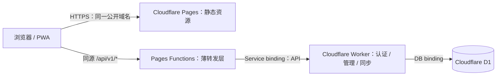

# rememberKey：Cloudflare Workers + Pages 重构设计

日期：2026-11-03。状态：本地实现已落地；真实 Cloudflare 部署与旧数据迁移验收尚未完成。

## 目标与已确认要求

交付一个由 Cloudflare Pages 托管 Web/PWA、Cloudflare Workers 提供 API、D1 保存数据的版本，无需常驻 Go 服务、MySQL 或容器。

用户已确认：**旧版 Go + MySQL 中的账号和密钥数据需要保留并迁移。** 保留账号、公钥、密文、设备身份、撤销状态、同步历史和操作幂等性；迁移过程不需要用户主密码，也不能解密用户密钥。

本次任务仅制定计划。真实账号部署、数据库导入、域名切换均属于后续实施。

## 当前仓库事实

| 部分 | 本次检查结果 | 对计划的影响 |
| --- | --- | --- |
| 后端 | `worker/src/` 已有 TypeScript API，含认证、管理、同步和 D1 访问 | 复用现有实现，重点验证旧协议兼容与部署边界 |
| 当前部署 | `worker/wrangler.jsonc` 使用 Workers Assets，D1 ID 仍为全零占位值 | 已有草稿不能当作真实 Cloudflare 部署通过 |
| 前端 | React 19、Vite 6、libsodium、IndexedDB、静态白名单 Service Worker | 保留客户端加密与相对路径 API |
| Pages | 没有 Pages 配置或 Functions 接入层 | 新增 Pages 静态部署及同源 API 转发 |
| 旧版 | Go/MySQL/Docker 代码位于 `legacy/` | 用于迁移源格式、兼容测试和切换前回退 |
| 工作区 | 有大量已有的已暂存与未暂存改动，部分目录已迁移 | 后续实施先记录基线，按文件审查，不能重置或整包覆盖 |
| 验证 | Worker 类型检查、36 项测试，Web 9 项测试及生产构建通过 | 只是本地基线；尚未验证 Pages、远程 D1 或真实迁移 |

Windows 前端构建首次遇到系统临时目录访问被拒绝；将当前进程的 `TEMP`、`TMP`、`TMPDIR` 指向 `web/.tmp` 后成功。构建存在约 1.23 MB JS 分块警告，性能优化不作为本次迁移的前置重写任务。

## 架构决策

1. **Pages 托管前端，Worker 保留完整业务逻辑。** Functions 只负责域名准入、内部转发与转发失败响应，不复制认证或数据库逻辑。
2. **浏览器始终同源访问。** `web/src/api.ts` 继续请求 `/api/v1`；刷新 cookie 保持 host-only、HttpOnly、Secure、SameSite=Strict、原有 Path；不引入跨域 API 地址或放宽 CORS。
3. **通过 Service binding 连接。** Pages 的 `API` 绑定指向指定 Worker；Worker 使用 `workers_dev=false`、`preview_urls=false`，不配置公开路由或自定义域，仅接受内部绑定调用。
4. **D1 是目标版本唯一业务存储。** 不引入 KV 保存会话、R2 保存普通密钥记录或 Durable Objects 重写同步。保持当前 D1 `batch` 与条件写入模型，暂不开启读副本。
5. **新版本以 Pages 为正式前端入口。** 当前 Workers Assets 形态保存为切换前版本工件，不长期维护两套静态资源分发实现。旧 Go/MySQL 在切换前保留可恢复备份。

### 环境与路由

| 环境 | 页面 origin | API Worker | D1 |
| --- | --- | --- | --- |
| 本地 | `http://127.0.0.1:8788`，Pages dev | 本地 `rememberkey-api`，8787 | 本地隔离状态 |
| 预发布 | Pages `staging` 分支的固定别名 | `rememberkey-api-preview` | `rememberkey-preview` |
| 生产 | 优先保留原有 HTTPS origin，否则使用选定 Pages 正式域名 | `rememberkey-api` | `rememberkey` |

Worker 的 `RK_ORIGIN` 与 Pages 的 `RK_ORIGIN` 必须等于该环境唯一公开页面 origin。正式项目名、数据库 ID、实际域名以创建或查询资源后的结果为准，并写入环境配置，不使用全零 ID 部署。

Pages 使用 `_routes.json`，仅 `/api`、`/api/*`、`/healthz`、`/readyz` 调用 Functions；静态资源直接走 Pages。API 未知路径返回 JSON 404，不能被 SPA 首页吞掉。API 与健康响应均 `Cache-Control: no-store`。静态资源的非 GET/HEAD 行为交给 Pages，协议文档明确区分静态站点行为与 API 的 Origin 校验。

预发布只在固定 `staging` 别名上启用认证。任意提交哈希域名、其他分支域名和非正式别名的 API 请求在 Functions 中拒绝；不接受 `*.pages.dev` 通配 Origin，不把预发布绑定到生产库。Pages 与 Worker 配置分别显式声明 production/preview 绑定，不能依赖非继承绑定的默认回落。

`_headers` 只负责 Pages 静态响应；Functions/Worker 自行保证 API 安全头。静态 CSP 支持 libsodium WASM 所需的 `wasm-unsafe-eval`，保持 `connect-src 'self'`，禁止第三方脚本。Service Worker 继续只缓存静态白名单，不能缓存 API、cookie、明文或迁移文件。

## 数据迁移规则

采用“**预演 → 停写 → 一致性全量导出 → 导入新 D1 → 全量核对 → 验收 → 切换 → 开放写入**”。个人密钥库优先选择可验证的短维护窗口，不引入双写或实时 CDC。

| MySQL 表 | 目标处理 |
| --- | --- |
| `accounts` | 原样保留 ID、用户名、公钥、bundle、bundle_version、角色、禁用状态和时间 |
| `devices` | 原样保留设备 ID、公钥、proof、创建时间及 revoked；不自动恢复已撤销设备 |
| `records` | 保留原始 envelope 字符串、签名、revision、base、operation 和删除墓碑 |
| `changes` | 保留原始 seq、account、record 文本；保留游标连续性及原有空洞 |
| `operations` | 保留 account、id、hash、result 原文，迁移后重放仍返回旧结果 |
| `audit` | 保留 seq 与原始事件字段；预检旧数据的 NULL 与目标 NOT NULL 差异 |
| `invitations` | 保留 hash、expires、used；新增 `used_by` 为 NULL，绝不把已用邀请恢复可用 |
| `challenges`、`families`、`access_tokens`、`refresh_tokens` | 不迁移；要求重新认证，旧会话失效 |
| `bootstrap_lock` | 不迁移；并发引导由目标 D1 实现承担 |

迁移已有账号后不设置引导令牌。保留现有账号密钥，不能用重新注册、普通“导入为新记录”或重新加密的方式替代数据库迁移。

### 一致性与兼容门槛

- 使用独立离线 Go 迁移工具，复用已有 MySQL 驱动版本；生产 Worker 不增加 MySQL 依赖。
- 使用只读、一致性快照事务读取 MySQL；最终快照前停用所有旧服务写入口、后台写入和签名同步提交。旧服务维护模式不以“只改网页按钮”代替服务端停写。
- SQL 以固定表列映射生成；文本编码为 UTF-8 十六进制字面量后 `CAST(... AS TEXT)`，区分 NULL、空串和文本。不能把 `mysqldump` 直接导入 D1，也不能 parse/stringify 已签名的 envelope。
- 检查每张保留表的行数、稳定主键排序后的全量 SHA-256、最大 seq、引用关系和原始文本字节；导入后逐表复算。仅对比数量不够。
- 保留 `changes`、`audit` 最大已用 seq，并保留源表 `AUTO_INCREMENT - 1` 高水位；设置或验证目标 `sqlite_sequence`，新插入序号必须大于该高水位。
- 导出时整数以十进制字符串处理；任何 API 会使用的 seq/revision/version 超过 `Number.MAX_SAFE_INTEGER` 则中止迁移，不允许精度截断。
- 旧表可为 NULL 的字段与 D1 NOT NULL 的不兼容数据必须在预检中报出；不静默填默认值或丢行。正常数据通过后再导入。
- 检查真实 MySQL 字符集、collation 与用户名。保证所有已存用户名原样可登录及 ASCII 大小写不敏感；MySQL 的 Unicode/重音等价匹配与 SQLite NOCASE 的差异单独列明，不能声称完全等价。
- 建立来自旧 Go 编码器的黄金样本，验证普通操作、删除操作、JSON 空白、HTML 字符及 Unicode 转义的操作哈希。已有 Worker 使用 `JSON.stringify`，需要验证其与 Go `json.Marshal` 的差异；必要时同时识别旧 Go 哈希和已有 Worker 哈希，新写入采用明确固定的版本。
- 导入只允许空目标库或本次失败后新建的目标库；不通过 `INSERT OR REPLACE` 掩盖重复数据。分片导入失败即停止，不向用户开放半成品库。
- 预演与正式迁移都先检查实际账号套餐下的 D1 容量、单行/语句大小、查询与导入限制；按数据实测选择分片，不能承诺一定处于免费额度内。

## 浏览器离线数据与域名

**优先保留旧公开 origin。** 同一 origin 下的 IndexedDB、公钥固定、加密设备私钥和 outbox 可以继续使用；重新登录后重放原操作，不能清空本地缓存解决迁移问题。

若旧版本只运行在 localhost、IP、HTTP 或无法保留的域名上，必须先在旧 origin 提供一次性客户端迁移功能。新域名不能读取旧域名 IndexedDB，HTTP 跳转也不能搬运这些数据。

迁移包包含 `LocalAccount`、密文记录、完整签名 outbox（含冲突双方）、游标、公钥固定和源 origin。包用独立随机 32 字节迁移密钥进行 AEAD 加密，密钥由用户另行保存；不能存主密码、恢复码、明文记录或未加密私钥。导入先用迁移密钥解封，再由用户主密码或恢复码验证账户密钥、设备身份和所有记录/队列签名；目标库只允许空状态，并在一个 IndexedDB 事务中恢复。

迁移包只在已迁移的同一账户、匹配公钥及管理员发布的固定目标 origin 下使用，不作为通用跨服务器导入能力。在线导入前核对服务端账号公钥及设备有效性；被撤销设备的包保持待恢复状态，不绕过撤销。

旧站迁移入口的交付本身是上线前条件；如果设备暂时离线或旧 origin 无法访问，保留旧端的恢复入口及原始本地数据，不声明该设备迁移完成。已有普通加密备份会导入为新 ID，不能替代这份保留 outbox 与设备身份的迁移包。

## 发布与回滚

部署顺序：新建隔离 D1 → 应用版本化 schema → 部署内部 API Worker → 配置 Pages service binding → 部署 Pages → 预发布全链路验收。生产导入期间 Pages 保持维护状态，不允许账号读写；验收完成才绑定正式入口并开放。

首选 GitHub Actions + Wrangler Direct Upload，保持 Worker 和 Pages 同一发布版本、固定依赖锁文件和显式环境。Cloudflare token 只出现在受保护的 CI environment/secrets 或本地安全环境中。PR 只验证本地环境，不持有生产权限。首次创建 Pages 时明确选择 Direct Upload，该项目不能原地切换为 Git integration。

回滚分两类：

1. **D1 尚未开放用户写入：** 可恢复旧入口与旧 MySQL，停止新入口；期间旧端仍保持停写直至入口恢复确认。
2. **D1 已有新写入：** 禁止把入口直接切回过期 MySQL。先停写并导出 D1；应用问题优先回滚到已验证兼容当前 D1 schema 的上一版 Worker/Pages。必须退回 MySQL时，使用经过演练的反向数据转换并全量核对，未提供该工具前只能维持维护状态，不能宣称无损退回旧库。

保持 schema 的向后兼容窗口，记录 Worker 版本、Pages deployment ID、D1 迁移版本和数据校验报告。D1 自动恢复能力取决于账号套餐；上线前确认，并保留独立导出备份与恢复演练。

## 验收与范围

必须分别记录：本地构建/测试、Pages 本地链路、预发布真实 Cloudflare、真实数据迁移、生产业务验收。通过一项不能代替其他项。

验收覆盖注册/邀请、登录/刷新/退出、旧账号解锁、设备撤销、管理员权限、记录增删改、离线重启、outbox 重放、冲突保留、跨账号隔离、旧游标续拉、API 不缓存、SPA 路由、WASM/CSP、域名与 Cookie。协议脚本的模拟 keyBundle 不能证明旧密钥真的可解密，必须补真实客户端密码学与浏览器测试。

本次不扩展桌面 Tauri、原生客户端、团队共享、WebAuthn、完整根密钥轮换、超大快照分页或独立密码学审计。

## 官方资料

以下文档已在本次规划中读取，实施时同时核对锁定 Wrangler 版本的行为：

- [Pages Service bindings](https://developers.cloudflare.com/pages/functions/bindings/#service-bindings)
- [Pages 路由与 _routes.json](https://developers.cloudflare.com/pages/functions/routing/)
- [Pages Wrangler 配置及生产/预览环境](https://developers.cloudflare.com/pages/functions/wrangler-configuration/)
- [Pages _headers 的适用范围](https://developers.cloudflare.com/pages/configuration/headers/)
- [Workers 配置与公开访问开关](https://developers.cloudflare.com/workers/wrangler/configuration/)
- [D1 导入与导出](https://developers.cloudflare.com/d1/best-practices/import-export-data/)
- [Pages Direct Upload 与 Functions 部署限制](https://developers.cloudflare.com/pages/get-started/direct-upload/)
